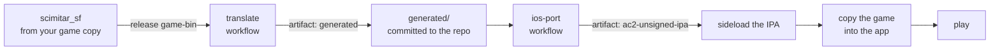
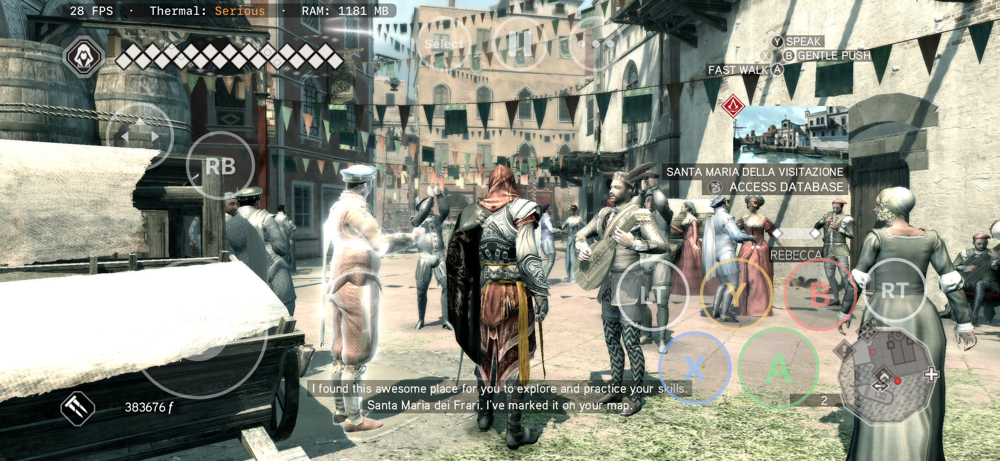
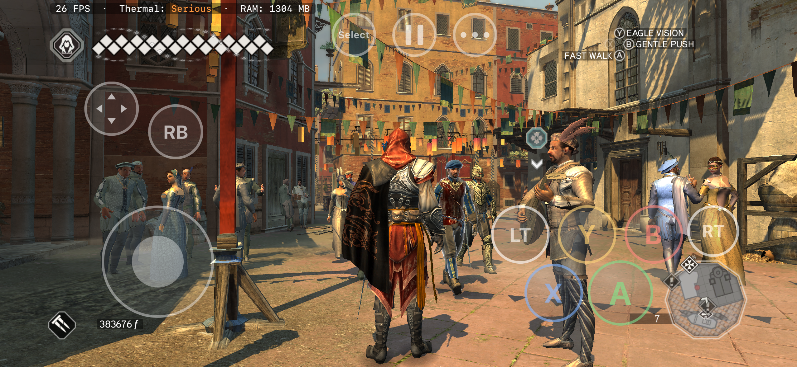
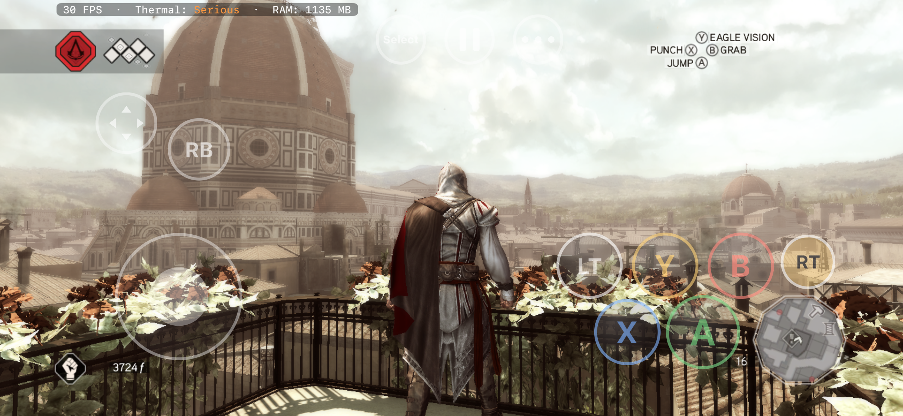
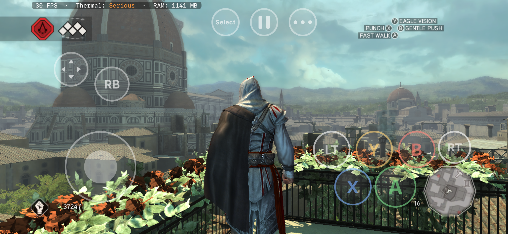
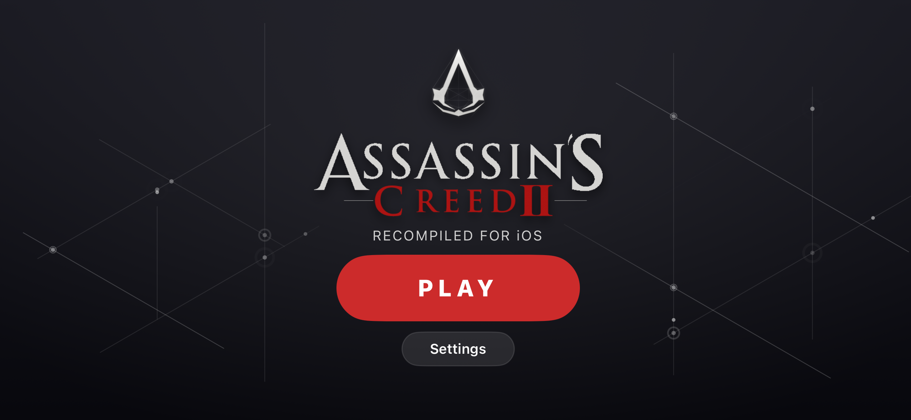

<h1 align="center">Assassin's Creed II - iOS Port</h1>

<p align="center">
  
  
  
</p>

<p align="center">
  
</p>

*Assassin's Creed II* running natively on iPhone. The game's Mac executable is
translated, function by function, into arm64 C++ and compiled into an iOS app with a Metal
renderer, a UIKit shell, on-screen touch controls and a launcher. Nothing is emulated.

**You do not need a Mac.** Two GitHub Actions workflows do the translating and the building
in the cloud, and you only sideload the finished app.

>[!important]
> This project is not affiliated with, endorsed by or connected to Ubisoft.
> *Assassin's Creed* is a trademark of Ubisoft Entertainment.
>
> **Keep your copy of this repository private.** The translated code in `generated/` is derived from Ubisoft's executable. No game files are in the source tree, and you
> need your own, legally obtained copy of the game.

## How it fits together



| Workflow | When to run it | What it makes |
|---|---|---|
| **translate** | Once, and again only when the translation's inputs change | `generated/`: the game's code as C++ (64 parts) |
| **ios-port** | Every time you want a new build | `ac2-unsigned-ipa`: the app, ready to sideload |

## Features

- **On-screen controls** for the whole game: floating sticks, a button cluster, a D-pad wheel
  and a menu to move, resize and pin buttons ([details below](#on-screen-controls)).
- **Game pads** (Xbox, PlayStation, other MFi controllers) with matching button prompts,
  and a keyboard and mouse on iPad.
- **A launcher** with a Play button and a Settings page: install status, save import, display,
  touch controls, graphics, languages and advanced options.
- **Graphics past the original maximums**: draw distance up to 6x, character detail,
  environment and shadow distances, 4096x4096 shadow maps and up to 16x anisotropic filtering.
- **Any screen shape**: the 3D view fills the phone's screen and the HUD sits at its edges.
  The original 16:9 framing remains an option.
- **Remove color filter**: switches off the color filter the game puts over the picture, the
  effect of the PC mod *AC2's True Colors*, without changing the game's files
  ([docs/AC2_COLOR_FILTER.md](docs/AC2_COLOR_FILTER.md)).
- **Save import**: bring in a Windows save or one from this port.
- **Languages**: text and voices chosen separately from every installed language.
- **Offline**: the Ubisoft online layer is replaced by a local one; saves stay on the device.

## Color filter: on and off

*Assassin's Creed II* puts a color filter over the picture in every world. This port can switch
it off, the same effect as the PC mod *AC2's True Colors*, without changing the game's files.
Turn it on in **Settings**, then **Display**, then **Remove color filter**
([how it works](docs/AC2_COLOR_FILTER.md)).

<!-- Add your four pictures to docs/images/ with these names (or change the paths below). -->
<table align="center">
  <tr>
    <td align="center">
      <br>
      <sub><b>Filter on</b> (original)</sub>
    </td>
    <td align="center">
      <br>
      <sub><b>Filter off</b> (Mod)</sub>
    </td>
  </tr>
  <tr>
    <td align="center">
      <br>
      <sub><b>Filter on</b> (original)</sub>
    </td>
    <td align="center">
      <br>
      <sub><b>Filter off</b> (Mod)</sub>
    </td>
  </tr>
</table>

## Status

Playable: the intro videos, the menus, the story from the start, and saves. Not played end to
end. Online features (Uplay rewards, Ubisoft accounts) depended on services that no longer
exist, so the game starts and saves offline. Tested on an **iPhone 15 Pro**.
other recent iPhones should work but have not been tested.

> [!IMPORTANT]
> This port will perform better with the increased memory limit entitlement. More information on how to set it up can be found here: [iRAM Repository](https://github.com/NexSideloading/iRAM-Plus)

## Quick start: build it with GitHub Actions

**You need:** a GitHub account, an iPhone or iPad on iOS 17 or later with about 9 GB free, your
own copy of the game, and a sideloading tool that re-signs apps with your Apple ID (for example
Sideloadly or AltStore).

### 1. Put the code in a private repository

Create a **private** repository and push this code to it. (A fork of a public repository stays
public, so make a new one.) The workflows are in `.github/workflows/`.

### 2. Get the game's executable

The port needs the Mac release **1.0.1**. A normal Steam install today brings the older 1.0.0
executable, which does not work. With the game owned, open the Steam console
(`steam://open/console` in a browser) and enter:

```
download_depot 33230 33362 5654928643791563232
```

Steam downloads the whole 1.0.1 app (about 7.5 GB) and prints the folder it wrote to. It holds
`Assassin's Creed 2.app`. For the translation you only need one file from it:

```
Assassin's Creed 2.app/Contents/MacOS/scimitar_sf
```

(More about the Mac releases: [docs/MAC_RELEASES.md](docs/MAC_RELEASES.md).) The workflow checks
the file's SHA-1, `afcbbbf8046c47561b2a5a0574a11703071f15e5`, so a wrong version stops right
away.

### 3. Translate the game (one time)

1. In your private repository, open **Releases**, then **Draft a new release**.
2. Create the tag `game-bin`, attach `scimitar_sf` (nothing else), tick **Set as a
   pre-release**, and **Publish**. It must be published: a draft has no tag yet, so the
   workflow cannot find it. Only you can see it, because the repository is private.
3. Open **Actions**, choose **translate**, and **Run workflow**. It runs on a macOS runner and
   can take a while (the job's limit is 5½ hours).
4. When it finishes, download the **`generated`** artifact. It is kept for **one day**, so do
   this right away. Unpack it so the files sit directly in `generated/` at the root of the
   repository (`generated/ac2_0.cpp` and the rest), then commit and push:

   ```bash
   unzip generated.zip -d generated
   git add generated && git commit -m "Add the translated game" && git push
   ```

5. **Delete the `game-bin` release and its tag.** The executable should not stay on GitHub.

The translator prints the size of its biggest file; it must stay under GitHub's 100 MB file limit.

### 4. Build the app

1. (Optional) Set the app's version at the top of `.github/workflows/ios-port.yml`
   (`APP_VERSION`).
2. Open **Actions**, choose **ios-port**, and **Run workflow**. One option:

   | Input | Default | Meaning |
   |---|---|---|
   | `gen_opt` | `-O1` | Optimization of the translated game code. `-O1` builds faster, `-O2` runs faster. |

3. When it finishes, download the **`ac2-unsigned-ipa`** artifact (kept for 3 days). Unzip it to
   get `ac2-unsigned.ipa`.

What the workflow does:
- Checks that `generated/` holds all 64 translated parts, and **fails if a game file
  (`scimitar_sf`, `.forge`, `.bik`, `.app`) is anywhere in the repository**.
- Builds FFmpeg for iOS, for the game's Bink videos (cached after the first run).
- Builds the `ac2` app for iOS arm64 (iOS 17 or later), with a build cache that makes later runs
  faster.
- Inspects the binary, sets the version, adds an ad hoc signature and packs the unsigned IPA.
- Writes any compile errors to the run's summary and uploads the logs as **`port-logs`**.

The app icon is `icon/icon.png` from this repository. Without it, the workflow can fetch the
game's own `AC2.icns` from a direct link in the `AC2_ICON_URL` repository secret, and without
either the app has no icon.

### 5. Install the app

Open the IPA with your sideloading tool and install it with your Apple ID. The tool replaces the
ad hoc signature with your own. An app signed with a free Apple ID expires after 7 days and must
be signed again.

### 6. Copy the game into the app

The app needs the game's own files: the whole **`Assassin's Creed 2.app`** from step 2 (about
8.7 GB). Copy it into the app's folder, either:

- in the **Files** app, under **On My iPhone** (or **On My iPad**), into the app's folder, or
- from a computer, through the device's file sharing in Finder (the device's **Files** tab).

Until the game is there, the launcher shows **INSTALL** instead of **PLAY** and takes you to the
Install tab. Once it is copied, reopen the app: it shows **Found** and **PLAY**.

## Updating

- **Only the app changed** (launcher, on-screen controls, graphics, fixes): run **ios-port**
  again.
- **The translation's inputs changed** (`recomp/`, `runtime/` or the game overrides in `games/`):
  run **translate** again, commit the new `generated/`, then run **ios-port**. This needs the
  `game-bin` release again. When unsure, running it again only costs time.

## Playing

Open the app. The launcher shows the logo, the title, **PLAY** and **Settings**. Settings has a
tab for each part ([games/common/launcher/README.md](games/common/launcher/README.md)):

<p align="center">
  
</p>

| Tab | What it has |
|---|---|
| **Install** | Where the game is, and whether it was found |
| **Save manager** | Import a Windows save (the `ACII 0` file from Ubisoft Game Launcher's savegames folder) or a save from this port; the save it replaces is backed up first |
| **Display** | Screen shape, frame rate, the statistics overlay, skipping the intro videos, Remove color filter |
| **Touch controls** | On-screen controls on, off or automatic, their size and opacity, haptics, RT's toggle, the camera trail, and Reset button layout |
| **Graphics** | Anisotropic filtering, draw distance, character detail, environment and shadow distances, shadow map size |
| **Language** | Text and subtitles, voices, button prompts |
| **Advanced** | Options for the engine's own command line |

A tap in the top left corner of the screen shows the statistics overlay (frame rate, CPU and
memory). The game's saves and settings live in the app's container on the device, so deleting
the app deletes them.

### On-screen controls

The **On-screen controls** setting is Automatic by default: the controls show while no game pad
is connected, and hide when one is.

- **Left stick:** put a thumb anywhere on the empty left side of the screen and the stick appears
  under it. Three quick taps lock a run: the stick stays pushed forward until you tap three
  times again. "Fixed left stick" in the menu keeps it in one place instead.
- **Camera (right stick):** drag anywhere on the empty right side. A line and a dot follow your
  finger; the menu can hide them.
- **Buttons:** X, A, B, Y, LT and RT sit together in the bottom-right corner. RT toggles on a
  tap (sprint); the launcher can turn that off.
- **D-pad:** one button. Hold it and a wheel opens under your finger; flick up, down, left or
  right.
- **Select, Start and the menu** (three dots) run across the top.
- **The menu:**
  - **Edit** opens the layout editor: drag a button to move it, tap one to resize it, and
    sliders set the overall size and the opacity.
  - **Mouse** lets touches that are not on a button through to the game as mouse clicks, for its
    menus.
  - **L3, R3, LB, RB** can be pressed from the menu, or pinned onto the screen with their plus
    buttons.
  - **Fixed left stick** and **Camera trail** switch those two on and off.
  - **Reset layout** (it asks twice) puts every button back in its default place and size, takes
    the pinned buttons off the screen, and restores the default size and opacity.

## Troubleshooting

| Problem | Likely cause |
|---|---|
| translate: the release is not found | The `game-bin` release is a draft, or the tag is not `game-bin`. Publish it as a pre-release. |
| translate: the checksum fails | `scimitar_sf` is not from the Mac **1.0.1** release. Download it again with `download_depot`. |
| ios-port stops at "Check the generated code" | `generated/` is missing or incomplete (it needs 64 `ac2_*.cpp` files) or the `generated` artifact was unpacked into a subfolder. |
| ios-port: "a game file is in this repo" | A `scimitar_sf`, `.forge`, `.bik` or `.app` was committed. Remove it from the repository. |
| The `generated` artifact is gone | It is kept one day. Run translate again. |
| The app shows INSTALL | The game is not in the app's folder yet (step 6), or the copy is incomplete. Reopen the app after copying. |
| The app stops opening after a week | The Apple ID signature expired. Sideload the IPA again. |
| A build fails | Open the run's summary (it lists the errors) and the `port-logs` artifact. |

## Building on a Mac instead

With a Mac, Xcode and [Homebrew](https://brew.sh), the same steps run locally. This also lets you
sign with your own provisioning profile and install with `xcrun devicectl`.

```bash
brew install cmake ninja zydis ffmpeg

# 1. translate the game (the translated code lands in build/gen/full)
cmake -S . -B build -DSCIMITAR_FULL_IMAGE=ON -DSCIMITAR_GAMES=ac2 \
      -DAC2_APP="/path/to/Assassin's Creed 2.app"
cmake --build build --target ac2 -j 10

# 2. FFmpeg for iOS, once (without it the game skips its videos)
tools/build_ffmpeg_ios.sh iphoneos

# 3. build, sign and install the app
cmake -S . -B build-ios -DCMAKE_SYSTEM_NAME=iOS -DCMAKE_OSX_SYSROOT=iphoneos \
      -DCMAKE_OSX_ARCHITECTURES=arm64 -DCMAKE_OSX_DEPLOYMENT_TARGET=17.0 -DCMAKE_BUILD_TYPE=Release \
      -DAC2_BUNDLE_ID=com.yourname.ac2 \
      -DAC2_SIGN_IDENTITY="Apple Development: <you>" -DAC2_TEAM_ID=<team> \
      -DAC2_PROFILE=/path/to/profile.mobileprovision \
      -DAC2_ICON_SOURCE=icon/icon.png
cmake --build build-ios --target ac2 -j 10
xcrun devicectl device install app --device <udid> build-ios/ac2.app
```

The iOS build compiles the translated code from `build/gen/full` (or from the folder in
`SCIMITAR_GEN_DIR`, which is how the workflow uses `generated/`). Signing, the Simulator, memory
options and the rest are in [games/ac2/ios/README.md](games/ac2/ios/README.md).

## Repository layout

| Path | Contents |
|---|---|
| `.github/workflows/` | `translate.yml` and `ios-port.yml`, the automation described above |
| `generated/` | The translated game (C++), committed from the translate workflow. Derived from Ubisoft's executable: keep it private |
| `recomp/` | The x86 to C++ translator |
| `runtime/` | Guest memory and CPU state for the translated code |
| `platform/` | Native replacements for what the game imported from the system, and the Metal renderer |
| `games/common/` | The UIKit shell, the launcher and the on-screen controls |
| `games/ac2/` | AC2's own code, and its iOS build (`games/ac2/ios/`) |
| `icon/` | The app icon |
| `tools/`, `tests/`, `fixtures/` | FFmpeg for iOS and helpers, tests, test data |
| `docs/` | Design notes |

## How it works

- **Recompiler** (`recomp/`): translates each x86 function to a C++ function. The Mac executable
  keeps its full symbol table (about 308,000 symbols), which gives exact function boundaries and
  lets the port replace engine functions by name.
- **Runtime** (`runtime/`): the game's address space lives in one reserved block of host memory;
  guest pointers stay 32-bit.
- **Platform layer** (`platform/`): native replacements for everything the game imported from the
  operating system, and a Metal renderer that translates the game's OpenGL calls and ARB shader
  programs.
- **Shell** (`games/common/`): the UIKit shell, the launcher and the on-screen controls.

More in [docs/PLAN.md](docs/PLAN.md), [docs/METAL.md](docs/METAL.md) and
[docs/AC2_DEV_OPTIONS.md](docs/AC2_DEV_OPTIONS.md).

## Repository rules

- Never commit game files: executables, `.forge`/`.pck`/`.bik` data, or dumps of the game's code,
  text or art. The ios-port workflow refuses to build if it finds one.
- The only game-derived content is `generated/`, and it belongs in a **private** repository. If
  you ever publish the source, leave `generated/` out.
- Nothing personal or machine-specific: no home paths, device IDs or signing identities.

[CLAUDE.md](CLAUDE.md) has the working rules, also for contributors who use Claude Code.

## Credits and license

Based on the [scimitar-recomp](https://github.com/T01iK/scimitar-recomp) project. Licensed under the GNU General Public License, version 2 or later ([LICENSE](LICENSE)).

## Disclaimer

This project is an independent, non-commercial static recompilation and iOS compatibility wrapper created strictly for **educational, research, and software preservation purposes**. 

* **No Copyrighted Assets Included:** This repository contains no copyrighted game data, executables, audio, textures, or proprietary assets. Users must legally own and supply their own original copy of the game to extract any required files locally.
* **Trademarks & Rights Holders:** *Assassin's Creed* and all related marks, logos, and game assets are the sole property of **Ubisoft Entertainment**. This project is not affiliated with, endorsed by, or sponsored by Ubisoft.
* **Takedown / Rights Holder Notice:** If you are a rights holder or authorized representative and have concerns regarding intellectual property or trademark usage in this repository, please open an issue or contact the maintainer directly. Upon verification, any disputed material—or the repository itself—will be promptly removed without objection.
